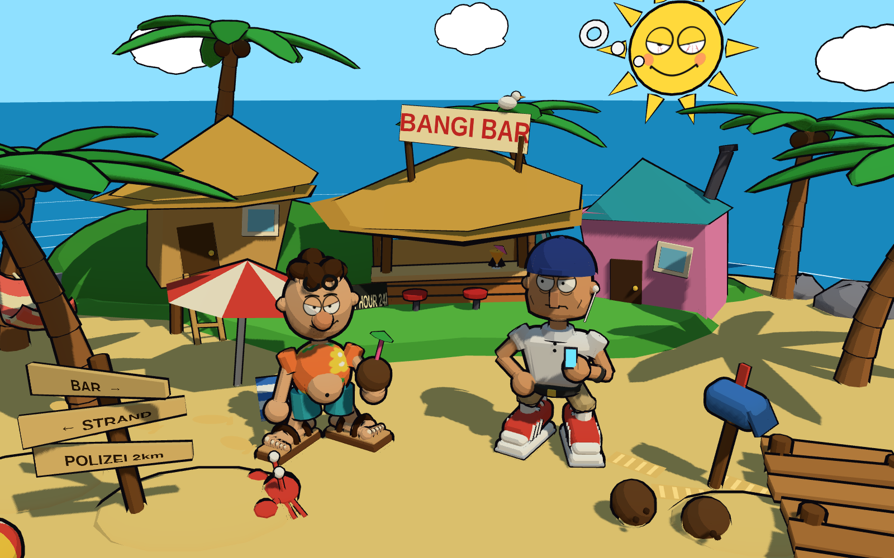

# Bangi

*Bangi* (Swahili für „Gras“) ist eine Spielidee für den Browser: Ein tiefenentspannter Typ schlurft durch einen
kleinen, schiefen Cartoon-Strandort und muss Leute lesen. Sandalen? Entspannt. Turnschuhe? Kann rennen.
Zu sauberes Hemd? Verdächtig. Ton: eher *The Big Lebowski* als *Breaking Bad*.

Hier gibt es noch kein Spiel, nur erste Bausteine:

- **`stiltest/`**: eine Stilprobe in [Three.js](https://threejs.org/) mit Toon-Shading, Tusche-Konturen
  (Inverted Hull) und gemalten Gesichtern. Alles ist prozedural im Code gebaut, ohne fremde Assets.
- **`spiel/`**: ein erster begehbarer Prototyp der Zone „Bangi Beach“ (WASD/Pfeile, Shift, Q/E, Klick).
- **`welt/`**: die Welt-Skizze „Bangi Bay“ (Karte von oben, Zonen, Fluchtrouten).



## Ansehen

Es gibt keinen Build-Schritt. Der Ordner muss nur über einen beliebigen statischen Webserver ausgeliefert werden,
weil ES-Module per `file://` nicht laden, zum Beispiel:

```sh
python3 -m http.server 8000
# dann http://localhost:8000/spiel/ (Prototyp) oder /stiltest/ öffnen
```

Three.js (`three@0.170.0`) kommt per Importmap von jsDelivr.
