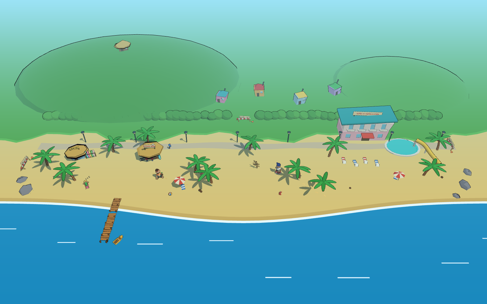

# Bangi Beach – begehbarer Prototyp

Erster begehbarer Stand der Zone „Bangi Beach“: ein Schluffi in Sandalen läuft über eine flache Strand-Bühne,
die Kamera folgt schräg von oben. Keine Spielmechanik — nur Laufen, Kamera, Kollision und die Welt spüren.
Der Look kommt aus der Stilprobe (`../stiltest/`): dicke Konturen, harte Toon-Stufen, schiefe Architektur,
gemalte Gesichter.



## Öffnen
Three.js (`three@0.170.0`) kommt per Importmap von jsDelivr, kein Build. ES-Module laden nicht von `file://`,
deshalb einen kleinen statischen Server im Ordner `spiel/` starten:

```
python3 -m http.server 8000
```

Dann `http://localhost:8000/` öffnen.

## Steuerung
- **WASD / Pfeiltasten** – gehen, relativ zur Kamera (Standard: oben im Bild = Richtung Meer)
- **Shift** – „rennen“ (Sandalen: nur ein bisschen schneller, dafür mehr Gewackel)
- **Q / R** – Kamera um den Spieler drehen
- **Klick / Tippen auf den Boden** – hinlaufen
- **Touch-Geräte** (automatisch, oder `?touch=1`): Joystick links (weit ausgelenkt = rennen), rechts große Buttons
  **Reden** und **Schauen**, darüber ↺ ↻ für die Kamera. Die Seite scrollt und zoomt nicht (`touch-action: none`).
  Auf schmalen Bildschirmen ist das HUD kompakt.
- **Hinweise:** Der ausführliche Hinweis (ansprechen, hinschauen, beenden) erscheint nur beim ersten Mal; danach
  blinkt ein kleines E/F-Badge über der Figur (mobil pulsieren die Buttons). In der Hinschau-Ansicht steht nur eine
  kleine Pille am Rand, die Figur bleibt frei. Gemerkt wird das in `localStorage` (robust, mit Fallback).
- **Ton:** 🔊/🔇 (alles) und 🎵 (nur Musik) oben rechts (erscheinen, sobald `js/audio.js` vorhanden ist). Audio startet erst nach der ersten
  Geste; die Spiellogik ruft nur Hooks (`sfx('kasse')`, `babble(kundeId, text)`, …); Brandung und Musik-Loop starten mit
  der ersten Geste; Schritte im Sand alle ~0,4 s Laufweg, Kasse/Heat/Verhaftet/Ausverkauft/Hinschauen/Klick als SFX.
  Die Ambience-Mischung (Strand / Markt / Posten / Hafen) folgt der Spielerposition (`zoneMix`, getestet; Mitten aus dem
  Markt-Layout).
  Barks kommen aus `audio.bark(kundeId, situation, { pan })` (Text + Gebrabbel, Stereo-Position aus der
  Bildposition des Kopfs), ohne Audio aus dem eigenen Picker.
- **E** – ansprechen (nur mit Kunde in Reichweite). In der Sprechblase: **1 / 2** oder Pfeile + **Enter**
  wählen (Verkaufen / Lieber nicht), **Esc** bricht ab.
- **F** in Kundennähe – genau hinschauen: die Kamera fährt vor die Figur, Füße bis Kopf, der Spieler wird dabei
  ausgeblendet. Nochmal F, Esc oder Weggehen beendet es. Das ist der Kern: Schuhe, Hemd und Accessoire muss man SEHEN.
  Die Tastenbelegung sind Konstanten am Anfang von `js/main.js`.
- Bis knöcheltief ins Wasser geht es, dann ist Schluss. Durch die Heckenlücke geht es nach Norden ins Dorf
  Krummgassen; die übrigen Ausgänge (Surfer-Bucht, Promenade, Dorf-Nordende) enden an Absperrungen.

## Mechanik v0 (Kern: Leute lesen)
- **Kundschaft** aus `data/kunden.json`, zur Laufzeit per `fetch` geladen; aus dem Katalog kommen 7 pro Tag an den
  Strand, davon 2 Zivis, die pro Tag rotieren (so sieht man über die Tage alle Fallen). Fehlende oder kaputte Felder bekommen Defaults, fehlt die Datei ganz, gibt es zwei
  Ersatzkunden. Figuren werden aus Teilen gebaut: Schuhe (Sandale, Flip-Flop, Turnschuh, barfuß, Gummistiefel),
  Hemd (Hawaii, Hawaii neu mit Bügelfalte, sauberes Polo, Tanktop, ohne, versteckte Uniform mit Dienstmarke, Kittel,
  Trikot), Hose (Shorts, Badehose, Chino, Jogginghose, Rock, lang), Haare (kurz, lang, lockig, Dutt, weiß, Glatze),
  Bart (Stoppeln und Vollbart gemalt, Schnauzer 3D), Brille (Lesebrille gemalt, Sonnen- und Sportbrille 3D),
  Accessoire (Cap, Ohrknopf mit Kabel, Hund an der Leine, Rucksack, Sonnenbrille, Kamera, Surfbrett, Gehstock, Handy,
  Kopfhörer) und Extras (Socken, Preisschild, Stirnband, Hundehalstuch, Funkgerät, Strohhut, Cocktail, Einkaufskorb,
  Bändchen). Die Fallen (Socken in Sandalen, Preisschild, Ohrknopf, Hund) sind bewusst groß. Hautton, Bart, Brille,
  Falten und Start-Stimmung gehen in die gemalten Gesichter (`face(kind, mood, opts)` aus `faces.js`). Tempo und
  Spawn-Code (K1–K6) sind im Katalog erhalten, die Plätze kommen aber aus `ANCHORS` in `js/logic.js`: jeder Kunde
  bekommt einen festen Ankerplatz (Liege, Bar-Hocker, Steg, Palme, Dorfecke …) mit Tätigkeit (sitzt, telefoniert,
  fotografiert, schaut aufs Meer, steht — Posen aus `pose()` in `js/figures.js`, auf Liegen wird gelegen); `assignAnchors()` hält Zivis ≥ 8 Einheiten von allen anderen Kunden fern
  (getestet), damit Verkaufen vor dem Zivi nicht der Normalfall ist. Kein Kreisen mehr. Noch nicht dargestellt: Rollator, Pulsuhr, Notizblock,
  „nass“, „schwitzt“, die Mimik-Beschreibungen und Tells (nur Text). Sie schauen dem Spieler nach, wenn er nah ist.
- **Ansprechen (E):** Sprechblase im Comic-Look über dem Kopf: Gruß → Wahl **Verkaufen / Lieber nicht** → Ergebnis.
- **Ergebnis:** Unbedenklicher → +Geld, Ware −1, Kunde zufrieden. Zivi → Heat +1…3, der Beutel ist weg (an die
  Polizei, kein Geld; umschaltbar über `ZIVI_BESCHLAGNAHMT` in `js/game.js`), Reveal-Satz, Kunde misstrauisch und setzt die Polizeimütze auf. Die Bilanz rechnet
  verkauft + an Zivis + übrig = Startware (getestet). Ablehnen → kleiner Satz. Jeder Kunde nur einmal pro Tag.
- **HUD:** Tag, 💰 Geld, 🌿 Ware (Start 5), Heat als Sirenen 🚨 (0–3). Heat 3 → „VERHAFTET. Tag verloren. Geld
  bleibt.“ → Enter startet den nächsten Tag (Ware voll, Heat 0, Kunden wieder neutral).
- **Tagesuhr:** Ein Tag dauert 7 Minuten Spielzeit (06:00 → 24:00 im HUD mit Sonne/Mond), Phasen morgen / mittag /
  abend / nacht (reine Logik in `js/game.js`, getestet; die Uhr pausiert in Gesprächen und Karten). Abends setzt sich
  der Mentor an die Bar, und der Schluffi denkt alle 20 s laut „ab in die Bar“ (`abend_bar.sonnenuntergang`).
  E beim Mentor am Tresen startet den Abend: Nong (Barkeeper) grüßt → Mentor-Rückblick nach Lage → letzte Runde →
  Nong fragt „Feierabend?“ (E/1 = ja, 2/Esc = noch nicht) → Bilanz-Karte mit Nongs Gute-Nacht-Zeile → neuer Tag.
  Spätestens nachts endet der Tag von allein in der Hängematte (Gähnen, kein Rückblick). Über Nacht kühlt der Heat:
  Bar −2, Hängematte −1. Nach einer Verhaftung bringt Pong den Schluffi abends an die Bar, der Mentor kommentiert
  (ohne Feierabend-Frage), dann die Bilanz (Heat 0). Nachschub gibt es nur morgens am Hügel. Im Bar-Abend schwenkt die
  Kamera von der Meerseite auf den Tresen (Dach bleibt sichtbar, nichts wird ausgeblendet). Rund um das Bar-Dach hängt
  eine Lichterkette, die abends glüht; in Bar-Nähe klirren Gläser (Ambience-Zone `bar`). Tagsüber ruft Nong beim
  Vorbeigehen am Tresen etwas (`barkeeper.zwischenruf`, höchstens alle 30 s).
  Licht: `licht.js → initLicht(scene, { sonne }).set(t01)` + `sunOffset(t01)` für die Schattensonne; Ton: `audio.setMood('tag'|'abend')`. `?t=0.72` setzt die Tageszeit,
  `?snap=1&scene=abend` / `scene=bar`.
- **Ausverkauft:** Bei Ware 0 meldet sich der Schluffi selbst in einer Sprechblase: **Tag beenden** zeigt die
  Tagesbilanz (verkauft, Geld, Heat) und startet den nächsten Tag; **Weiterbummeln** lässt einen die Leute weiter
  lesen. Die Bilanz-Karte wählt einen Spruch nach Lage (gut / heat / nichts / verhaftet) aus `data/texte.json`
  (robust, Platzhalter `{tag}`, `{verkauft}`, `{geldHeute}`, `{geld}`, `{heatLabel}`); fehlt die Datei, gibt es
  Standardtexte. `?snap=1&scene=bilanz` zeigt die Karte.
- **Outfits ohne Doppel:** Pro Tag bekommt jeder Kunde eine Hemd-Variante (Hawaii: Muster blumen/streifen/punkte/
  palmen × 6 Farben als Canvas; andere Hemden: 6 Farben), gleiche Hemd-Typen am selben Tag nie dieselbe Variante
  (`assignOutfits`, getestet). Orange bleibt dem Spieler.
- **Mentor-Szene:** Auf der Kuppe (Heckenlücke bei x −54…−46, dann die Serpentine hoch) steht der Mentor im
  Garten. E = zuhören: Ankunft → Lektion des Tages aus `texte.json → mentor[]` (drei Blasen: Einleitung, Regel,
  Pointe; ab Tag 4 „ausgelernt“) → Nachschub (Ware wird auf 5 aufgefüllt) → Abschied (Heat −1). Einmal pro Tag;
  nochmal: „schon geholt“, mit voller Tasche: „voll“. Logik rein in `js/game.js` (`mentorSzene`, `finishMentor`,
  getestet), Texte aus `mentor_szene{}`. `?snap=1&scene=mentor` zeigt die Regel-Blase.
- **Posten 7 (Heat-Zone):** In Pongs Sichtweite (Radius 15) gibt ein Verkauf an einen Zivi doppelt Heat, dazu
  Trillerpfeife. Am Mango-Stand des Markts kauft man Mangos (E, 10 Münzen, 🥭 im HUD); bei Pong (E) senkt eine
  Mango den Heat um 1 — einmal pro Tag, nur mit Mango und nur bei Heat > 0 (Texte aus `texte.json → posten7`).
  Die Tafel am Posten zeigt den echten Stand „Tage ohne Vorfall“ (zählt pro Tag hoch, Verhaftung → 0). Logik in
  `js/game.js`, getestet. `?snap=1&scene=mango` zeigt den Kauf.
- **Hafen:** Die Welt reicht jetzt bis x 100. Auf dem Steg darf man bis zum Anleger hinaus, durch die Furt (Untiefe mit
  Trittsteinen) kommt man nur mit Sandalen oder barfuß — Turnschuhe bleiben an der Wasserkante (`resolveCollisions` mit
  `schuhe`, getestet). In der Untiefe gilt Wat-Tempo 0,6; Flip-Flops stolpern alle ~3 Einheiten auf den Trittsteinen
  (0,8 s Stillstand). Fähren-Gäste bekommen Hafen-Plätze, weil der Strandweg zum Hotel durch Bootsschuppen und
  Felsnase gesperrt ist (nur die Furt führt hinüber). Kunden mit Spawn-Code K1 kommen mit der Fähre: sie steigen beim Anlegen am Steg aus und
  gehen zu ihrem Platz; die Fähre tutet beim An- und Ablegen, am Tuk-Tuk würgt Somchai den Motor ab. Der
  Pier-Ausgang des Markts ist offen, die Ost-Absperrung der Promenade ist weg.
- **Tuk-Tuk-Express (F3):** E am Tuk-Tuk — Somchai fährt dich zur Bar; Preis laut Schild 20 Mangos, sonst 40 Münzen,
  sonst nichts. Die Fahrt beendet eine Verfolgung (die Streife verliert die Spur). Logik `tukTukRide` in `js/game.js`,
  getestet. Der Motor säuft im 8-s-Takt ab (Sound nur in Hörweite).
- **Streife P1:** ein Polizist in Sandalen (Mütze, Ohrknopf, Funkgerät) läuft Posten 7 ↔ Markt über die Ringstraße
  (Wegfolgen und Sichtkegel als reine Funktionen in `js/logic.js`, getestet: ±60°, 12 Einheiten). Sieht er einen
  Verkauf, gibt es Heat +1 und Trillerpfeife; ab Heat 1 pfeift er bei jeder Sichtung (höchstens alle 8 s).
  **Verfolgung:** ab Heat 2 folgt sie dem Spieler (3,0 statt 4,0 Einheiten/s — Sandalen, zu Fuß entkommt man),
  verliert ihn nach 6 s ohne Sicht oder sobald er in einem Versteck steht (Bettlaken, Gedränge), und kehrt dann zur
  Route zurück; fängt sie ihn, ist das eine Verhaftung (Tag verloren, Geld bleibt). Schalter `schuhe`: in Sandalen
  watet sie mit Wat-Tempo 0,6 durch die Furt, in Turnschuhen bleibt sie an der Wasserkante stehen („These are new!“).
  Reine Logik `chaseStep` in `js/logic.js`, getestet. `?snap=1&scene=streife` / `scene=verfolgung`.
- **Reveal-Gags:** `data/texte.json → reveal_gags[]` (id, wann = kauf | ablehnung | immer, mood, extra, dauer_s) werden
  von `js/gags.js` gespielt: nach Verkauf bzw. Ablehnung der passende Gag des Kunden (hält den Endzustand, bis man
  weitergeht), „immer“-Gags alle 6–10 s als Idle-Tick, wenn der Spieler in der Nähe ist — der Hinweis zum
  Leute-Lesen. Während eines Gags steht der Kunde still und bekommt keine Schlender-Pose. `?snap=1&scene=gag&id=zivi_3`
  zeigt einen Kunden mitten im Kauf-Gag.
- **Barks:** `data/stimmen.json` liefert je Stimme kurze englische Ausrufe (gruss, kauf, ablehnung,
  zivi_verdaechtig). Lookup: `zuordnung[id]` → `stimme`-Feld des Kunden → id. Beim Näherkommen ruft der Kunde
  einen Gruß, nach Verkauf/Ablehnung etwas hinterher, Zivis beim genauen Hinschauen etwas Verdächtiges — als
  kleine Blase über dem Kopf (2–3 s), nie zweimal hintereinander dieselbe Zeile (getestet). Dieselbe Zeile geht
  als `babble(kundeId, text)` ans Audio (Gebrabbel). `?snap=1&scene=bark` zeigt eine Gruß-Blase.
- **Mimik:** `setMood(figur, stimmung)` tauscht nur die Gesichtstextur; sobald `faces.js` eine Funktion
  `face(kind, mood)` exportiert, wird sie automatisch benutzt, bis dahin bleiben die vorhandenen Gesichter.
- **Logik rein und getestet:** `js/game.js` (Zustand, Verkauf/Heat/Ware, Verhaftung + neuer Tag, Gesprächs-
  Zustandsautomat, nächster Kunde, Schlendern, Hinschau-Kamera) mit `test/game.test.js`.
- Standbilder: `?snap=1&scene=dialog` (Sprechblase in der Wahl-Phase), `?snap=1&scene=inspect` (Hinschau-Kamera auf
  den Zivi), `?snap=1&scene=lineup` (alle Kunden in einer Reihe), `?snap=1&scene=ausverkauft` (Ausverkauft-Meldung).

URL-Parameter: `?at=start|bar|mitte|hotel|verleih|ost|hecke|overview|dorf|platz|waesche|hunde|nord|huegel|garten|markt|marktmitte|posten|ring|pier|steg|tuktuk|furt|zufahrt` setzt den Startpunkt, `?cy=-90` dreht die
Kamera (Grad, relativ zum Standard), `?stats=1` zeigt Draw-Calls/Dreiecke/FPS, `?snap=1` rendert ein einzelnes
Standbild (für die PNGs in `shots/`).

## Dateien
- `index.html` – Seite, Importmap, Fehler-Overlay.
- `js/logic.js` – **reine Logik ohne Three.js/DOM**: Eingabe → Richtung (mit Kamera-Gierung), Bewegung mit
  Anlauf/Bremsen, Kollision (Kreise + Rechtecke, Rausdrücken in zwei Durchgängen), Uferlinie als Funktion,
  Welt-Grenzen, Folge-Kamera, Watschel-Pose, NPC-Kopfdrehung, Klick-Ziel.
- `test/logic.test.js` – Tests dazu (`npm test` bzw. `node --test "test/**/*.test.js"`), kein Browser nötig.
- `js/zone-pier.js` + `js/zone-pier-layout.js` – Tuk-Tuk-Pier (Hafen) östlich von x 66: Steg mit Anleger, Fähre alle
  60 s, Tuk-Tuk, Furt zum Hotelstrand (eingehängt aus `world.js` mit `buildPier()`).
- `js/zone-markt.js` + `js/zone-markt-layout.js` – Mango-Markt östlich des Dorfs und Posten 7 nördlich mit Ringstraße
  (eingehängt aus `world.js` mit `buildMarkt()`; liefert Spots, Ankerplätze, Tafel-Setter).
- `js/zone-huegel.js` + `js/zone-huegel-layout.js` – Zone „Kiffer-Kuppe“: Heightfield mit Serpentine, Mentor-Hütte,
  Garten, Mentor (eingehängt aus `world.js` mit `buildHuegel()`; `height(x, z)` hebt Spieler und Kamera).
- `js/zone-dorf.js` + `js/zone-dorf-layout.js` – Zone „Krummgassen“ nördlich der Hecke (eigenes Modul, wird aus
  `world.js` mit `buildDorf()` eingehängt; liefert Startpunkte, Bettlaken-Verstecke und die Rand-Collider).
- `js/world.js` – die Zone: Sand, Sichelbucht (Wasser, nasser Sand, Schaum), Gras und Hügel im Norden, Promenade
  mit Laternen, Hecke mit Lücke, Absperrungen, Bangi Bar, Steg + Boot, Verleih mit Surfbrettern und schlafendem
  Surfer, Hotel mit Pool und Rutsche, Liegen, Hängematte, Wegweiser, Sandburgen, Muscheln, Seesterne, Krabben,
  Treibholz, Fußspuren; liefert die Collider gleich mit.
- `js/figures.js` – Schluffi (Spieler) und Turnschuh-Typ (NPC) mit Pivot-Gruppen statt Rig.
- `js/props.js`, `js/faces.js`, `js/toon.js` – Bauteile, gemalte Gesichter, Toon-Material + Konturen
  (Material-Cache pro Farbe).
- `js/game.js` – **reine Mechanik** (Geld/Ware/Heat, Kunden-Normalisierung, Gespräch, Schlendern), getestet.
- `js/kunden.js` – Kundenfiguren aus Teilen, `setMood()`.
- `js/ui.js` – HUD, Sprechblase, Verhaftet-Bildschirm (HTML-Overlay).
- `data/kunden.json` – Kundschaft-Katalog (Inhalt).
- `js/main.js` – Szene, Licht, Eingabe, Spielschleife, Kundschaft, Standbild-Modus.

## Technik
- **Koordinaten:** x nach Osten, z nach Süden (zum Meer). 1 Laufsekunde ≈ 4 Einheiten, Figur ≈ 2.75 hoch,
  Zone ≈ 132 × 40 Einheiten → einmal quer ≈ 33 s gehen.
- **Maßstab der Gebäude:** je Gebäudetyp eine eigene Skala in `BUILDING_SCALES` (Bar und Hotel 1.5, Verleih,
  Dorfhäuser und Mentor-Hütte 2.1); die Gruppen werden damit vergrößert, ihre Collider rechnen Offsets und Maße mit
  (`scaledRect`/`scaledCircle`). Ein Test sichert, dass jeder Typ Skala und Basismaße hat, jedes Gebäude mindestens
  1.5 × Figurenhöhe hoch ist und Türen figurengroß sind. Palmen (1.4), Laternen (1.4), Schirme,
  Liegen, Absperrungen (1.3) und Wegweiser (1.25) sind moderat mitgewachsen; Figuren und Kleinkram nicht.
- **Bewegung:** Richtung aus Tasten relativ zur Kamera; Tempo läuft weich an und aus; die Figur dreht sich
  exponentiell in Laufrichtung. Die Watschel-Phase wächst mit der tatsächlich zurückgelegten Strecke, also bleibt
  die Animation vor einer Wand stehen.
- **Gebäude-Positionen und -Grundrisse** stehen als Daten in `js/logic.js` (`BUILDING_POS`, `buildingFootprints()`);
  ein Test prüft, dass kein Gebäude-Collider den Promenadenweg schneidet.
- **Kollision:** Spieler = Kreis (r 0.6). Stämme, Pfosten, Hocker, NPC = Kreise; Gebäude, Theke, Steg, Liegen,
  Absperrungen = achsenparallele Rechtecke (etwas größer als das sichtbare Objekt). Rausdrücken zum nächsten Punkt
  auf dem Rand, zwei Durchgänge für Ecken. Danach Welt-Grenzen und Ufer: `shoreZ(x)` + knöcheltiefe Zugabe.
- **Kamera:** fester Offset (13 zurück, 13 hoch, ≈ 45°) um die Gierung gedreht, Position und Blickpunkt
  exponentiell nachgezogen. Standard steht die Kamera im Norden und schaut übers Land aufs Meer — so ist das Wasser
  fast immer im Bild; mit Q/E dreht man sich die Hütten und Hügel ins Bild.
- **Verdeckung:** Jeden Frame gehen zwei Strahlen von der Kamera zum Spieler (Kopf- und Kniehöhe, damit auch
  hängende Palmenkronen zählen). Palmen haben zusätzlich eine Kronen-Kugel (Mitte Stammspitze, Radius Blattlänge):
  berührt sie die Sichtlinie, wird die Palme ohne Mesh-Raycast ausgeblendet, weil die flache Krone vom Strahl oft
  verfehlt wird. Für alles andere ist der Vorfilter die reine Funktion
  `isOccluder()` (Kugel schneidet die Sichtlinie oder liegt vor der Linse, getestet), danach ein Raycast gegen die
  Meshes der Kandidaten. Getroffene Props werden als ganze Gruppe auf 25 % Deckkraft gesetzt — inklusive
  Kontur-Hülle (der Kontur-Shader hat dafür ein `opacity`-Uniform). Weil Materialien pro Farbe geteilt sind, bekommt
  jedes ausgeblendete Mesh eine Materialkopie und beim Einblenden sein Original zurück. Boden, Wasser, Himmel und
  Hügel sind per `userData.noFade` ausgenommen.
- **Watscheln ohne Rig:** Beine und Arme sind Gruppen mit Pivot an Hüfte/Schulter und drehen gegenläufig um x;
  die Sandale hebt die Ferse, wenn das Bein nach hinten schwingt; der Oberkörper (eigene Pivot-Gruppe an der
  Hüfte) wippt, kippt seitlich und lehnt sich beim Rennen vor; der Kopf gegenläufig dazu.
- **NPC:** der Turnschuh-Typ steht in der Mitte des Strands und dreht den Kopf dem Spieler nach (Anschlag ±63°,
  weich).
- **Licht/Schatten:** eine Sonne mit 2048er-Schattenkarte, deren Ausschnitt (64 × 64) mit dem Spieler mitwandert;
  Hemisphärenlicht als Grundhelligkeit; leichter Nebel für Tiefe.
- **Performance:** Materialien ohne Textur werden pro Farbe geteilt. Statische Deko ist noch nicht zu großen
  Meshes zusammengeführt — mit `?stats=1` lässt sich der Draw-Call-Stand ablesen, das ist der erste Hebel, wenn
  es auf einem Laptop ruckelt. Pixel-Ratio ist auf 1.5 gedeckelt.

## Offen / nächste Schritte
- Statische Deko zusammenführen (Hecke, Palmen, Laternen) und Konturen als Screen-Space-Pass, falls die
  Draw-Calls auf schwächeren Rechnern bremsen.
- Steg begehbar machen (derzeit ein Block, man läuft am Strand daran vorbei).
- Mehr Leben: Rentner auf den Liegen, Streife auf der Promenade, Möwe, Wellen mit leichter Bewegung.
- Kamera-Alternative zum Ausprobieren: Kamera im Süden (Welt liegt wie auf der Karte, Gebäude zeigen ihre Fronten,
  Meer dafür unten im Bild) — nur eine Konstante (`DEFAULT_CAM_YAW`).
- Übergänge zu den Nachbarzonen (Krummgassen, Promenade/Pier) statt Absperrungen.
